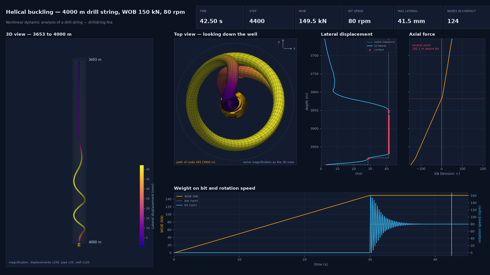
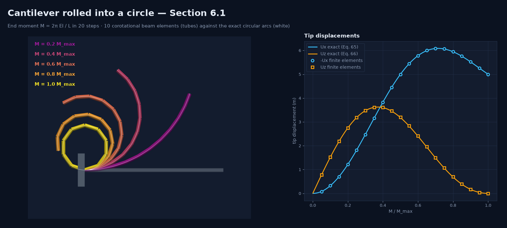

# drillstring-fea

Finite element program for the **nonlinear dynamic analysis of oil-well drill
strings**, written in Python for teaching and research. It implements the
formulation of the MSc dissertation

> L. P. de Aguiar Neto, *Nonlinear Dynamic Behavior of Oil-Well Drill Strings*,
> PUC-Rio, 2021. [doi:10.17771/PUCRio.acad.56800](https://doi.org/10.17771/PUCRio.acad.56800)



*A 4000 m drill string (Section 6.5) with a weight on bit of 150 kN: once the
rotation starts, the bottom ~110 m wrap around the well wall in a helix
(command in [Helical buckling](#drill-string-dashboard)).*

* 3D corotational Euler-Bernoulli beam, 6 DOFs per node (Sections 4.2-4.4);
* Newton-Raphson iterations and Newmark time integration (Sections 4.5-4.7);
* contact with the well wall and with the rock through penalty springs (Section 4.8);
* the examples of Chapter 6 (buckling of tubing in a well, 4000 m rotating drill string, ...).

Every published result is reproduced by the automatic tests, e.g. the
cantilever rolled into a full circle by an end moment (Section 6.1):



The code comments refer to the equations of the dissertation, so the code can
be read side by side with it: [docs/theory.md](docs/theory.md) maps each
equation to the code, suggests a reading order, explains the corrections and
lists the validation. The program is written for clarity: the analysis itself
(model, element, contact, solver, results and cases) is about 1500 lines of
Python, comments included, using only NumPy and SciPy.

---

## 1. Installation

Requires Python 3.11 or newer.

```bash
git clone https://github.com/aguiarln/drillstring-fea.git
cd drillstring-fea
python -m venv .venv
# Windows:            .venv\Scripts\activate
# Linux / macOS:      source .venv/bin/activate
pip install -e ".[plot,dev]"
```

`[plot]` installs Matplotlib (used in `examples/`), `[dev]` installs pytest and ruff.
For 3D animations and dashboards also install `[animation]` (PyVista, imageio, ffmpeg, Matplotlib):
`pip install -e ".[plot,dev,animation]"`.

## 2. Running the cases of the dissertation (terminal)

```bash
drillstring-fea list                     # cases, their parameters and default values
drillstring-fea run pure_bending         # run a case; results go to results/pure_bending.npz
```

General form:

```bash
drillstring-fea run CASE [name=value ...] [-o FILE.npz] [--corrections PRESET]
```

Each `name=value` is either a **parameter of the case** or an **analysis
setting**. Text values need no quotes; lists are written as `(15,30,45)`.

### 2.1 Cases and their parameters

| Case | Dissertation | Parameters (default) |
|---|---|---|
| `appendix_a_cantilever` | Appendix A — 1-element cantilever, iteration by iteration | — |
| `pure_bending` | 6.1 — cantilever rolled into a circle | `n_elements` (10) |
| `column_buckling` | 6.2 — slender column, post-buckling | `n_elements` (10), `load_ratio` (1.0 = P_crit) |
| `composite_column` | 6.3 — eccentric load | — |
| `curved_cantilever` | 45° curved cantilever (Aguiar 2013, Table 3) | `n_elements` (8), `load_ratio` (7.2) |
| `tubing_in_well` | 6.4 — 100 m tubing buckling in a well | `case` (1-4, Table 3), `n_waves` (1), `k` (10), `n_elements` (200) |
| `rotating_drillstring` | 6.5 — 4000 m rotating drill string | `rpm` (80), `wob_rate` (5000 N/s), `t_rotation` (16.1 s), `stabilizers` (none; heights above the bit, m), `torsional_inertia_factor` (1/420; 0 = no torsional inertia), `wall_stiffness` (1e7 N/m) |

### 2.2 Analysis settings (any case)

| Setting | Meaning | Default |
|---|---|---|
| `n_static_steps` | number of static load steps | case dependent |
| `dynamic` | run the dynamic phase after the static one | case dependent |
| `t_final` | duration of the dynamic phase (s) | case dependent |
| `dt` | time step (s) | 0.01 |
| `beta`, `gamma` | Newmark parameters (Eqs. 23-24) | 0.25, 0.50 |
| `max_iter` | maximum Newton-Raphson iterations per step | 100 |
| `tol_disp`, `tol_res` | convergence tolerances (Eqs. 34-35) | 1e-4, 1e-2 |
| `ramp_time` | duration of the "ramp" load history (s) | 5 |
| `save_every` | keep every n-th step in the result file | 1 |

### 2.3 Examples

```bash
# 6.1 with 20 elements
drillstring-fea run pure_bending n_elements=20

# 6.2 following the post-buckling path up to 3 P_crit
drillstring-fea run column_buckling load_ratio=3

# 6.4, case 2 (force control), 10 s of dynamic analysis, every 10th step saved
drillstring-fea run tubing_in_well case=2 t_final=10 save_every=10 -o results/tubing_case2.npz

# 6.5 at 120 rpm with the three stabilizers
drillstring-fea run rotating_drillstring rpm=120 "stabilizers=(15,30,45)"

# 6.4 exactly as computed in the dissertation
drillstring-fea run tubing_in_well --corrections dissertation

# 6.5 without torsional inertia, stopping right after the rotation starts
drillstring-fea run rotating_drillstring torsional_inertia_factor=0 t_final=17
```

Running times on a laptop: 6.1-6.3 below 1 s; 6.4 (30 s of simulation) about
30 s; 6.5 (36 s of simulation, 630 elements) 1-2 minutes.

## 3. Extracting results

Every run writes a `.npz` file (default `results/CASE.npz`).

### 3.1 From the terminal (CSV files)

```bash
drillstring-fea info results/tubing_case2.npz                    # summary of the file

# all nodes at one step: coordinates, displacements and internal forces
drillstring-fea export results/tubing_case2.npz --step 500 -o results/step500.csv

# one node and one DOF along the whole analysis (time history)
drillstring-fea export results/tubing_case2.npz --node 200 --dof DZ -o results/bottom_dz.csv
```

`--step` CSV columns: `node, x, y, z, DX, DY, DZ, RX, RY, RZ, N, Vy, Vz, T, My, Mz`
(initial coordinates, displacements/rotations and internal forces: axial force,
shear forces, torque and bending moments, in element axes; **N > 0 in
compression**, see [results.py](src/drillstring_fea/results.py)).
`--node` CSV columns: `step, time, <DOF>_node<N>`. Without `--step`, the last step is exported.
DOF names: `DX DY DZ` (translations, m) and `RX RY RZ` (rotations, rad).

### 3.2 From Python

```python
from drillstring_fea import Result, DZ

r = Result.load("results/tubing_case2.npz")
r.steps, r.time                 # saved step numbers and times
r.displacements(step=500)       # (n_nodes, 6) at step 500 (default: last step)
r.history(node=200, dof=DZ)     # one value per saved step
r.section_forces(step=500)      # (n_nodes, 6): N, Vy, Vz, T, My, Mz
r.forces                        # (n_steps, n_elements, 12) element end forces
r.coords, r.connect             # initial geometry
```

### 3.3 What is inside the `.npz` file

A `.npz` file is NumPy's standard archive: a zip file containing one array per
name. It can be opened without this package:

```python
import numpy as np
data = np.load("results/tubing_case2.npz")
data.files                      # ['model_name', 'coords', 'connect', 'steps', 'time', ...]
data["U"]                       # (n_steps, 6 * n_nodes) displacements, DOF 6*node + d
```

| Array | Shape | Content |
|---|---|---|
| `coords`, `connect` | (n_nodes, 3), (n_elements, 2) | initial geometry |
| `steps`, `time`, `static_ratio`, `iterations` | (n_steps,) | step number, time of the dynamic phase, static load ratio, Newton iterations |
| `U` | (n_steps, 6 n_nodes) | displacements and rotations |
| `forces` | (n_steps, n_elements, 12) | element end forces `[N1 Vy1 Vz1 T1 My1 Mz1 N2 ... Mz2]` |

## 4. 3D views and animations

Each element is drawn as a cylinder (16 panels) whose end rings follow the
displaced nodes, inside the well, with the drill bit at the bottom node.

```bash
# MP4 video of a result file (drill strings: magnify displacements and diameters)
drillstring-fea animate results/tubing.npz -o results/tubing.mp4 \
    --scale 250 --pipe-scale 20 --well-scale 125 --color-by lateral

# only the lower 350 m of the 4000 m string, from step 1700, colored by the bending moment
drillstring-fea animate results/rotating_drillstring.npz -o results/bha.mp4 \
    --start 1700 --z-max -3650 --scale 250 --pipe-scale 20 --well-scale 125 --color-by My

# 3D window of one step (or a picture with --png)
drillstring-fea show results/tubing.npz --step 500 --scale 250 --pipe-scale 20 --well-scale 125
```

| Option | Meaning | Default |
|---|---|---|
| `--scale` | magnification of the lateral (x, y) displacements | 1 |
| `--axial-scale` | magnification of the axial (z) displacements | 1 |
| `--pipe-scale`, `--well-scale` | magnification of the pipe / well diameters | 1 |
| `--rings` | `tangent`: rings perpendicular to the drawn axis (round cylinders); `rotations`: rings turned by the node rotations | `tangent` |
| `--color-by` | `N Vy Vz T My Mz` (section forces) or `lateral` (lateral displacement) | none |
| `--z-min`, `--z-max` | draw only part of the string | all |
| `--start`, `--end`, `--every`, `--fps` | steps of the video and frame rate | all, 1, 25 |

The original animations of the dissertation used `--scale 250 --pipe-scale 20 --well-scale 125`.
From Python: `drillstring_fea.animation.animate(result, "movie.mp4", displacement_scale=250, ...)`
and `drillstring_fea.animation.show(result, step, ...)`.

### Drill-string dashboard

For drill strings, `dashboard` produces a presentation-ready video (1920 x 1080)
with a 3D view, a top view looking down the well (the same pipe panels, with
the same magnification and colors, and the path of a node), the lateral
displacement and axial force along the depth (contact points and neutral point)
and the time histories of the weight on bit and of the rotation speeds, plus
indicator cards.

```bash
drillstring-fea run rotating_drillstring t_final=21 save_every=10 -o results/ds.npz
drillstring-fea dashboard results/ds.npz -o results/ds.mp4 --start 1500 --z-min -4000 --z-max -3650 \
    --title "Section 6.5 - 4000 m rotating drill string"
drillstring-fea dashboard results/ds.npz -o results/ds.png --step 1900 --z-min -4000 --z-max -3650
```

Options: `--color-by lateral|N|T|My|Mz`, `--node` (node whose path is drawn in the
top view; default: largest lateral motion), `--z-min/--z-max`,
`--scale/--pipe-scale/--well-scale` (defaults 250/20/125), `--start/--end/--every/--fps`,
`--title`.

**Helical buckling.** With the WOB of Section 6.5 (80 kN) the lower string buckles
in a plane (sinusoidal shape). Raising the WOB above the helical buckling load of
the HWDP (Wu, Table 1: F = 5.55 (EI q²)^(1/3) = 70.8 kN; 123.7 kN for the drill
collars) gives a helix once the rotation starts: with 150 kN (5 kN/s up to
t = 30 s) the bottom ~110 m wrap around the well in continuous contact
(about 2.5 turns, pitch ~60 m):

```bash
drillstring-fea run rotating_drillstring t_rotation=30 t_final=45 save_every=2 -o results/helical.npz
drillstring-fea dashboard results/helical.npz -o results/helical.mp4 --start 1652 \
    --z-min -4000 --z-max -3650 --title "Helical buckling - WOB 150 kN, 80 rpm"
```

From Python: `drillstring_fea.dashboard.dashboard(result, "board.mp4", z_range=(-4000, -3650))`.

## 5. Building your own model

See [examples/my_own_model.py](examples/my_own_model.py): a pipe in a well,
written from scratch in about 40 lines (nodes, elements, section, supports,
loads, contact, settings). Load histories (`"linear"`, `"constant"`,
`"ramp"`, `"hold"`, ...) are described in
[src/drillstring_fea/loads.py](src/drillstring_fea/loads.py).

## 6. Code map

| File | Content | Dissertation |
|---|---|---|
| `model.py` | input data: `Model`, `Settings`, `Corrections`, supports, loads | Ch. 4 |
| `loads.py` | load histories | 4.7 |
| `beam.py` | rotations, element matrices, corotational update | 4.2-4.4, 4.7 |
| `contact.py` | well-wall and rock springs | 4.8 |
| `solver.py` | Newton-Raphson + Newmark loop | 4.5-4.7 |
| `results.py` | results, `.npz` files, CSV export | — |
| `animation.py` | 3D views and MP4 animations (PyVista); `data/` drill-bit mesh | — |
| `dashboard.py` | drill-string dashboard (3D, top view, profiles, histories) | — |
| `pipes.py` | drill string from pipe sections | 2.7, Table 8 |
| `cases/` | the examples of Chapter 6 | Ch. 6 |
| `cli.py` | `drillstring-fea` command | — |

Other folders: `tests/` (automatic tests, including the published results),
`docs/theory.md` (equations → code, implementation notes, validation) and
`examples/` (scripts using the package from Python; `readme_figures.py`
draws the pictures of this page).

## 7. Validation

| Check | Reference | This code |
|---|---|---|
| Appendix A, residual per iteration (*) | 10000 / 393.47 / 0.125 | 10000 / 393.47 / 0.1253 |
| 6.1, Table 2, errors with 10 elements (*) | 0.0802 % / 0.2945 % | 0.0802 % / 0.2945 % |
| 6.2, tip at P = 2 P_crit vs exact elastica | x/L = 0.7968 | 0.7984 |
| 45° curved cantilever, tip at λ = 7.2 (Crisfield) | (15.61, 46.84, 53.71) | (15.57, 46.74, 53.73) |
| 6.4, bottom force at steps 229 / 525 | 38.2 / 86.7 kN | 38.3 / 87.2 kN |
| 6.5, WOB and neutral point at step 1760 | 80 kN, 92.0 m | 80.0 kN, 92.2 m |

(*) with `--corrections dissertation`, which reproduces the iteration-by-iteration values;
all other rows use the default corrections. Details: [docs/theory.md, Part 3](docs/theory.md#3-validation).
Run the tests with `pytest` (fast) or `pytest -m slow` (long reproductions).

## 8. Citation and license

If you use this code, please cite the dissertation:

```bibtex
@mastersthesis{AguiarNeto2021,
  author = {de Aguiar Neto, Luiz Pereira},
  title  = {Nonlinear Dynamic Behavior of Oil-Well Drill Strings},
  school = {Pontifícia Universidade Católica do Rio de Janeiro (PUC-Rio)},
  year   = {2021},
  doi    = {10.17771/PUCRio.acad.56800}
}
```

The code is distributed under the [MIT License](LICENSE).
